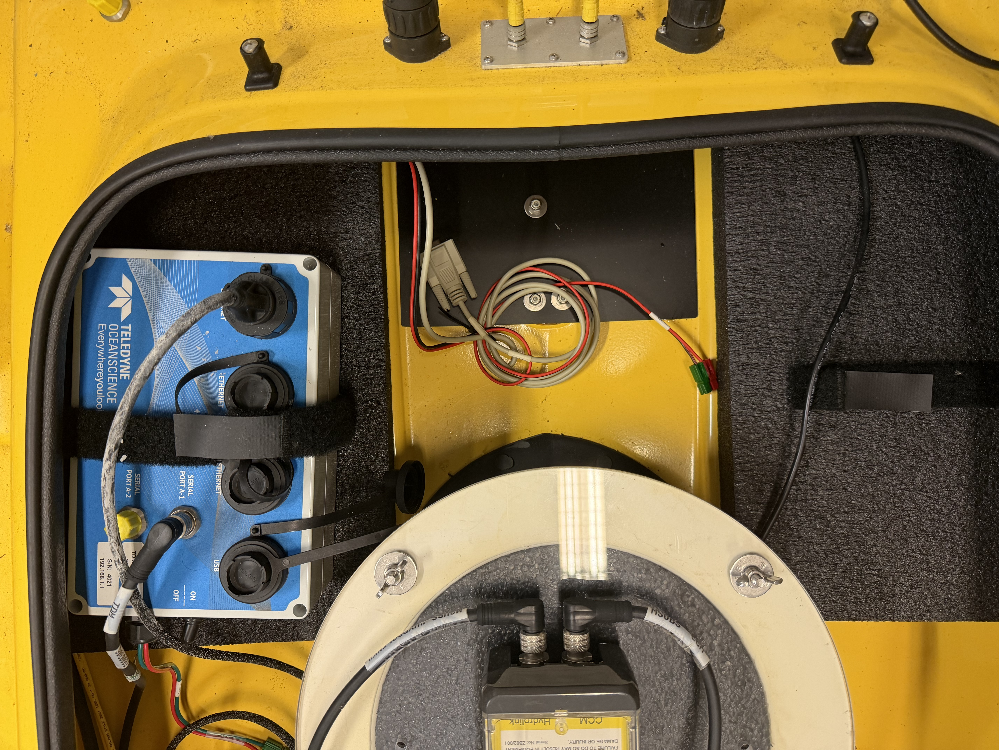
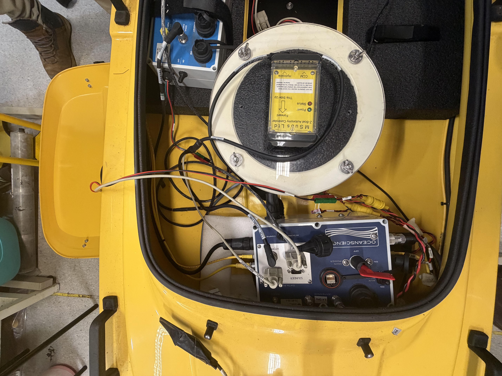
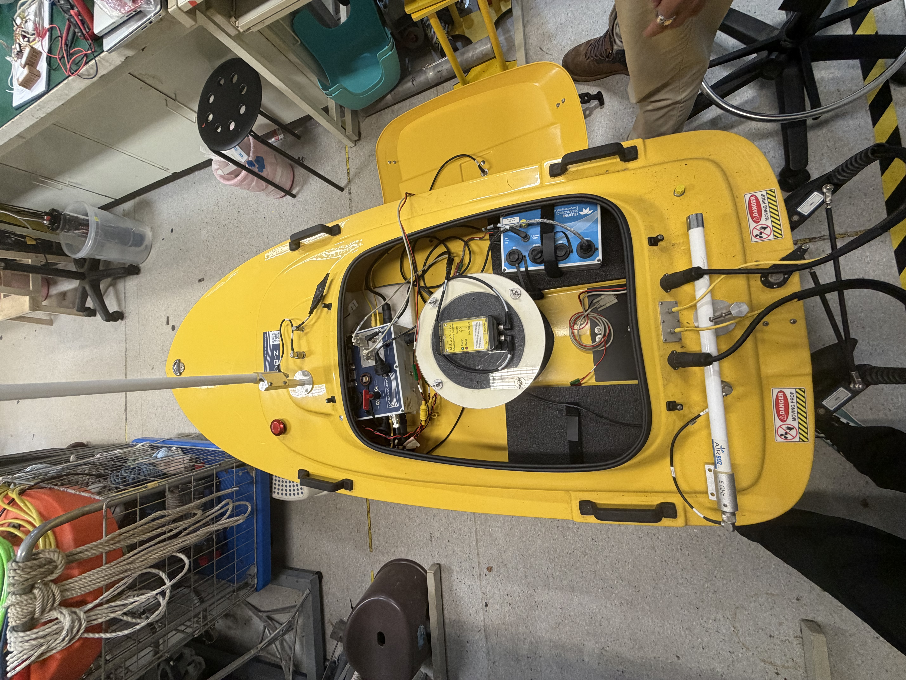
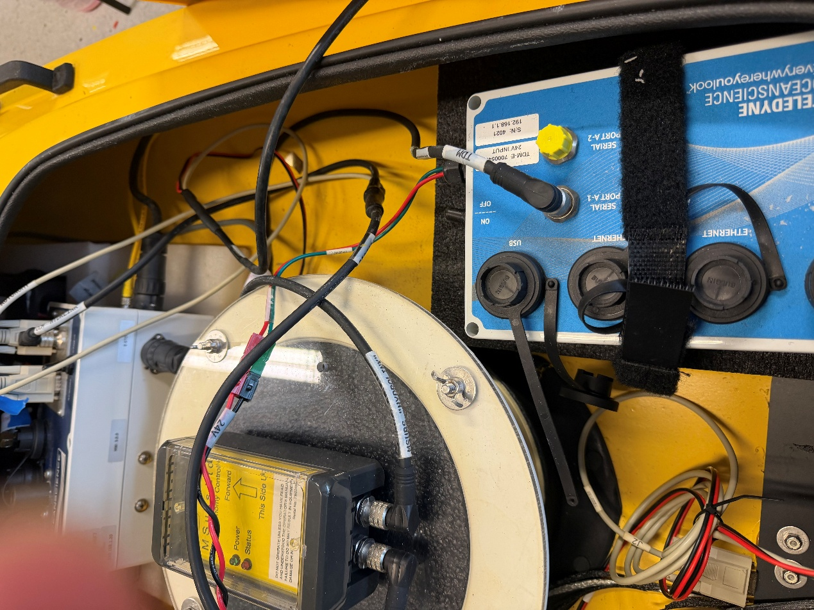
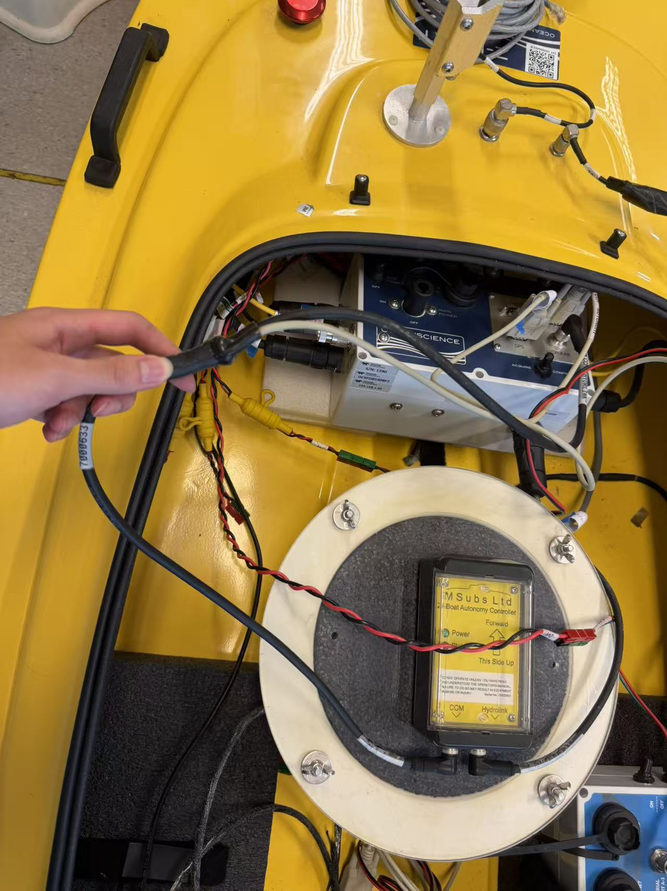
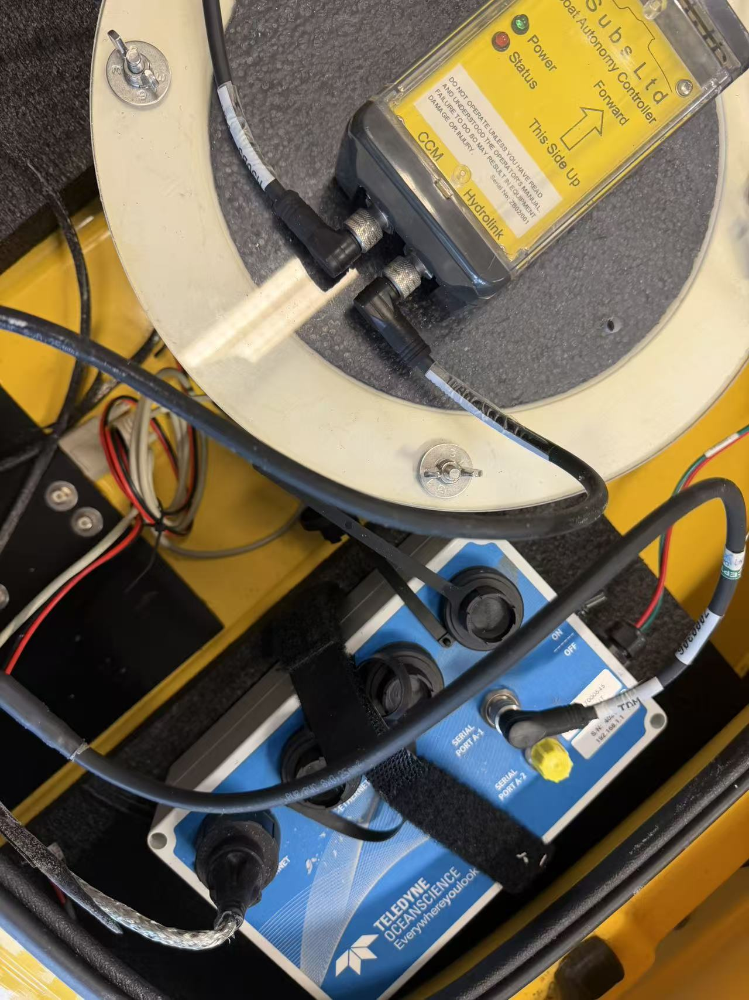
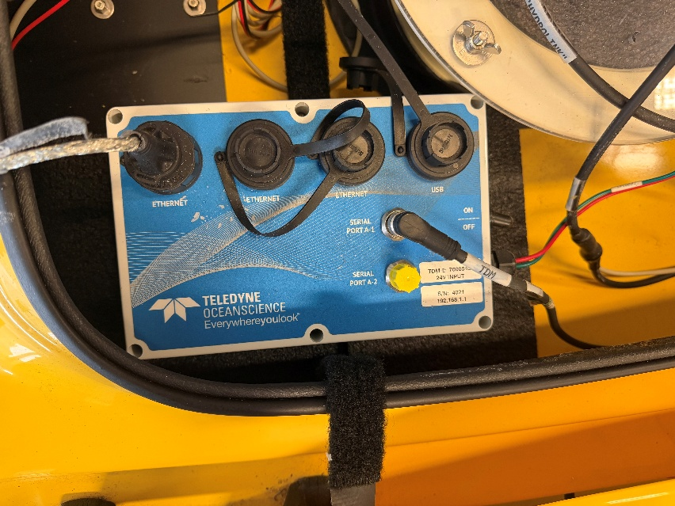
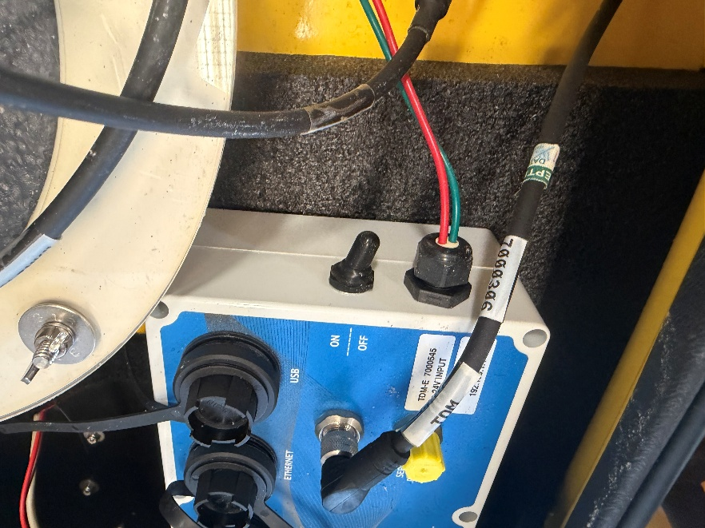
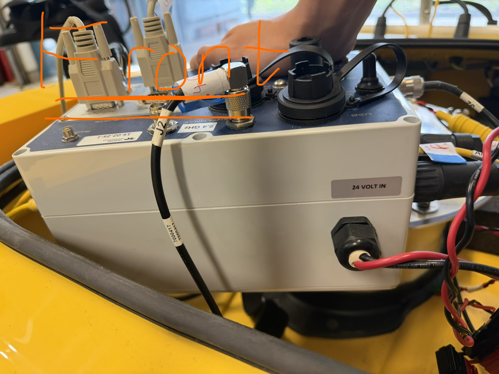

# Original Word transcription

Original wording, spelling, and paragraph order are retained below. Empty layout paragraphs are omitted. Photo links point to the retained assets; duplicate occurrences reference the same file. This is a source record, not an instruction to execute the document's TODOs.

Overall dimensions photo:

TO DO: Need to double verify the connections of the central CCM ABD CENTRAL HYDDROLINK, Not sure what does the serial port A1 connect to

Central component:

Outputs- CCM/ Hydrolink

Photo:

TDM – E

Outputs – Ethernet, Serial port A-1, 24voltage input

24v input is connected to one of the 24 input wires from the control and communications module

Photo:

Wire connections in the Control and Communications module

Dimensions Overall – Up, Left, Right, Front, Back

Front:

Output - 24Volt IN

Photo:

24volts connections:

The 24Volts cables derives into 2 smaller cables, one is connected to the TDM-E component, while the other cables is derived into 6 smaller cables which are connected to the battery at the front of the boat

Back

Output cable – E-stop

Photo:

Up

Output connections: 2.4Ghz, Sounder, Autonomy, GPS, Hydrolink

Picture:

HDMI Outputs:

Autonomy – Autonomy is connected to a white cable labelled CCM AUTONOMY

GPS – GPS is connected to a white cable labelled GPS

Hydrolink – hydrolink is connected to a cable labelled CCM HYDRLINK

Photo of connections:

2.4GHZ

2,4GHZ – 2.4GHZ is connected to a black cable labelled 2.4GHZ and 2J, which ultimately connects to the white stick at the outside and 2J at the outside

Photo:

Left hand side

Left Hand side output connections– 5GHz, Port Motor, P.S, AUX12V OUT

Photo:

Port Motor

Port Motor output is connected to a wire labled Left port motor, #maybe used to power the motor

Photo:

5GHZ

5GHZ output is connected to a wire labelled 5G

Photo:

P.S

A yellow wire labelled Left P.S. connected to the P.S. output which all the way connects to end of the boat to one of the propellors

Photo:

AUX12V OUT

AUX12V OUT is connected to a cable labelled with 12V, it then further divides into 3 smaller wires each with a green and red head labelled with J2, J3, J4

Photo:

Right

Right hand side connections – Starboard Motor, S.S, Servo

The cables connected are all lead to the cables that are fixed on the right hand side of the wall

Photo:

